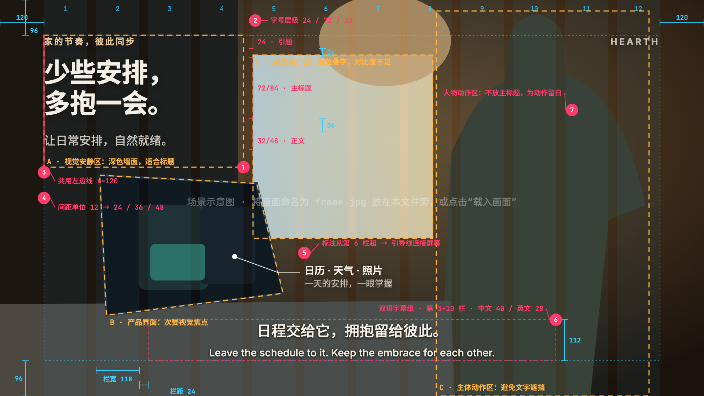
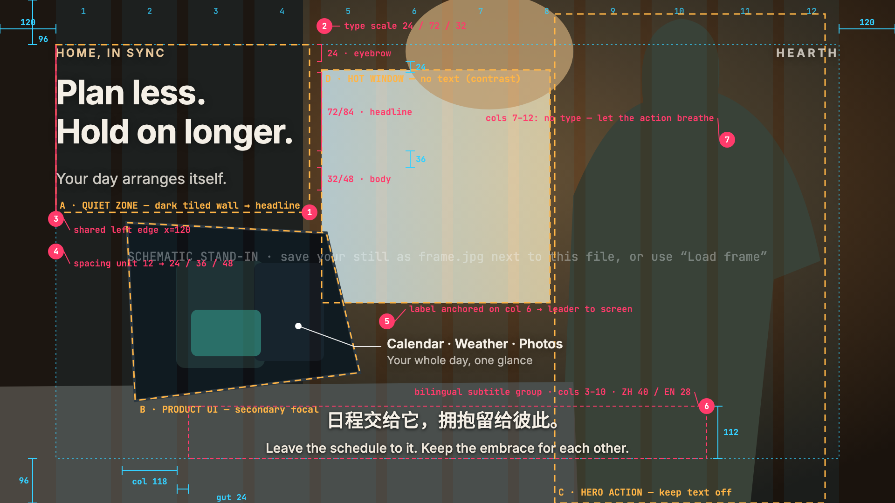
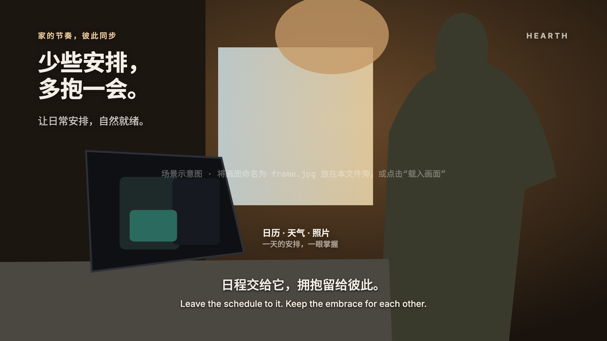

# 1920×1080 视频文字排版模板 · Video Grid Layout Template

基于 Josef Müller-Brockmann《平面设计中的网格系统》的视频画面排版参考：12 栏网格、字号层级、间距节奏、内容分区与红线标注，随时可作为 16:9 画面的排版底稿。

A 16:9 (1920×1080) text-layout reference for video frames, built on the grid principles in Müller-Brockmann's *Grid Systems in Graphic Design*: 12-column grid, type scale, 12-px spacing rhythm, content zones and redline annotations.



| 带标注 · Annotated | 纯文字 · Clean |
|---|---|
|  |  |

## 画面排版生成器 · Frame Layout Finder

`layout-finder.html`：载入任意照片，在浏览器本地分析画面（繁杂度、显著主体、高光、对比度），在 12 栏网格上评估约 3000 个文字位置，给出 3 个最佳方案，并按 8 条原则逐项检查、绘制红线标注。支持中英切换、编辑文案、生成 PNG、复制布局参数 JSON。照片不会上传。

`layout-finder.html` loads any photo, analyses it locally (busyness, salient subject, highlights, contrast), scores about 3,000 grid-aligned text positions and returns the 3 best layouts, each checked against the 8 principles with redline annotations. Chinese/English UI, editable copy, PNG output and layout JSON. Photos never leave the browser.

用法：直接用浏览器打开该文件，点击“载入照片”，或拖入、粘贴图片。

**手动摆放 · Manual placement**：直接拖动主标题，或用方向键微调（↑↓ 12px，←→ 一栏，Shift ×4）。位置始终吸附栏线与 12px 网格，不越过边距、不压字幕区；拖动边框四角或左右边的方块可直接缩放：栏宽吸附栏线，字号自动取能放进框内的最大一档（72/84/96/108/120，均落在 12px 网格上）；放不下文案时停在最窄可行的栏宽。也可切换对齐（自动/左/中/右）、栏宽（3–10 栏）和字号，或按 + / − 换字号。开启严格模式时，违反原则 1 或 7（压主体、区域过杂、对比不足）的位置会自动吸附到最近的合规位置；实时徽标显示安静度、主体重叠和对比度。

Drag the headline or nudge it with the arrow keys. It always snaps to column edges and the 12-px grid, stays inside the margins and clear of the subtitle zone. Drag a corner or side handle to resize: the width snaps to columns and the type takes the largest size that fits the box (72/84/96/108/120, all on the 12-px grid); if the copy can't fit, the width stops at the narrowest one that works. Alignment, width (3–10 columns) and size are also adjustable, and + / − step the size. Strict mode moves any spot that breaks principle 1 or 7 to the nearest spot that passes; a live badge shows quietness, subject overlap and contrast.

| 原则 · Principle | 生成器如何执行 · How the finder applies it |
|---|---|
| 1 文字放在安静处 | 选繁杂度最低、不压主体的区域 · lowest-busyness area clear of the subject |
| 2 清晰字号层级 | 24 / 72–96 / 32–36 三级 · three distinct sizes |
| 3 共用对齐边 | 左、右或居中对齐到栏线 · left/right/centre on a column edge |
| 4 12px 间距 | 所有坐标与间距吸附 12px · everything snaps to 12 px |
| 5 标注贴近对象 | 引导线连到第二视觉对象 · leader line to the secondary object |
| 6 字幕独立区 | 第 3–10 栏底部，过亮自动加底衬 · cols 3–10, band added when too bright |
| 7 有意留白 | 惩罚与主体重叠 · overlap with the subject is penalised |
| 8 出现节奏 | 按字数估算停留时间 · hold time estimated from copy length |

## 使用 · Usage

1. 用浏览器打开 `index.html`（中文）或 `index.en.html`（English）。
2. 载入画面：点击“载入画面 / Load frame”，或把图片拖到画面上，或将图片命名为 `frame.jpg` 放在同一目录（已在 `.gitignore` 中忽略，不会被提交）。
3. 顶部按钮可分别开关：网格、内容分区、排版标注、文字；“切换文案”轮换示例文案。
4. 导出 1920×1080 PNG（无界面）：

```bash
"/Applications/Google Chrome.app/Contents/MacOS/Google Chrome" --headless=new --hide-scrollbars --window-size=1920,1080 --virtual-time-budget=6000 --screenshot=out.png "file://$PWD/index.html?export=1&copy=0"
```

URL 参数 · Params: `export=1` 仅输出画布 · `copy=0–3` 选择文案 · `hide=grid,zones,notes,copy` 隐藏图层。

## 网格规格 · Grid spec

| 项目 | 数值 |
|---|---|
| 左右边距 · side margins | 120 px |
| 上下边距 · top/bottom | 96 px |
| 栏数 · columns | 12 |
| 栏宽 · column | 118 px |
| 栏距 · gutter | 24 px |
| 间距单位 · spacing unit | 12 px → 24 / 36 / 48 / 72 |
| 引题 · eyebrow | 24 px |
| 主标题 · headline | 72 / 84 |
| 正文 · body | 32 / 48 |
| 标注 · data label | 28 + 24 |
| 字幕 · subtitles | 中文 40 / 英文 28，第 3–10 栏居中 |

栏宽计算：`(1920 − 120×2 − 24×11) ÷ 12 = 118`

## 套用到新画面 · Adapting to a new frame

内容分区（A–D）与文字坐标是按示例画面设定的。换画面时：

1. 先找出画面中的**安静区**（暗、平、无运动）放标题，标出**主体动作区**和**高亮区**避开文字。
2. 在 `#zones` 中改分区矩形，在 CSS 中把 `#eyebrow / #headline / #body / #tag` 移到对应栏位。
3. 保持字号层级、12 px 间距和共用左边线不变——这才是跨镜头的一致性。

The A–D zones and text positions are set for the sample frame. For a new shot, find the quiet area for type, mark the hero action and bright areas as no-text, then move the zone rectangles in `#zones` and the text blocks in CSS onto the matching columns. Keep the type scale, spacing unit and shared left edge unchanged.

## 说明 · Notes

- 示例文案与品牌名 “HEARTH” 均为虚构占位。Sample copy and the “HEARTH” brand are placeholders.
- 仓库不含原始参考画面；未载入画面时显示场景示意图。No source footage is included; a schematic stand-in renders until you load a frame.
- 尺寸为 1920×1080 设计像素，需在真实素材和目标设备上检查对比度与可读性。
